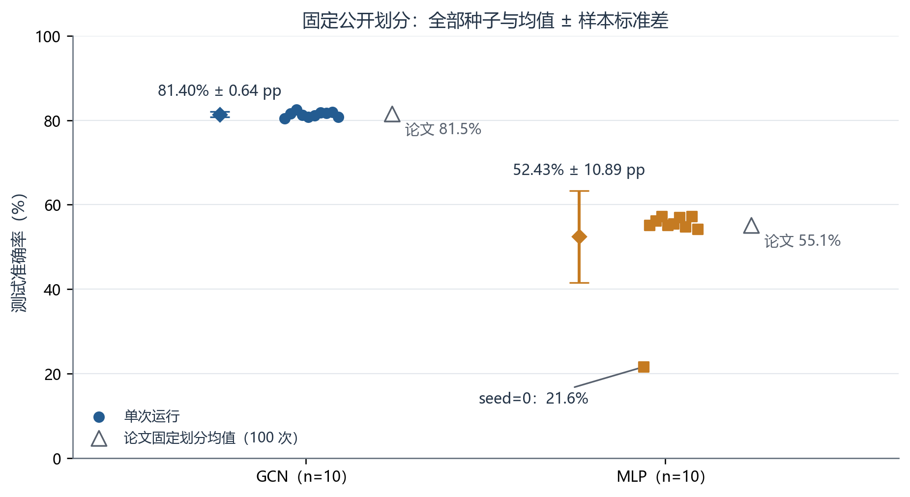

# GCN Cora Reproduction

**两层 GCN 的 Cora 核心复现：PyTorch + 同参数量 MLP 对照 + 固定划分 10 seeds。**

Core reproduction of Kipf & Welling (ICLR 2017) on the fixed public Cora split. This is an independent learning/reproduction project, not the authors' official code or a full reproduction of every paper experiment.

**[打开训练可视化](https://jinglangqiu-hub.github.io/gcn-cora-reproduction/) · [阅读完整报告](docs/report.md) · [下载 PDF、权重和预测](https://github.com/jinglangqiu-hub/gcn-cora-reproduction/releases/tag/v0.1.0)**

| 方法 | 初始化次数 | 测试均值 | 样本标准差 | 论文固定划分参考 |
| --- | --- | --- | --- | --- |
| GCN | 10 | 81.40% | 0.64 个百分点 | 81.5%（100 次） |
| MLP | 10 | 52.43% | 10.89 个百分点 | 55.1%（100 次） |



相同 seed 的 GCN-MLP 平均差为 **28.97 个百分点**，全部 10 个配对均为正。标准差按 ddof=1 计算；它描述固定划分下的种子波动，不是置信区间。MLP seed=0 在第 22 轮正常早停，测试准确率 21.6%，完整保留在统计中。详见 [全部 20 次结果](results/test_runs.csv)、[协议与差异](docs/protocol.md)。

## 快速开始（CPU）

Python 3.11。先克隆并进入项目根目录，使用独立环境；以下安装步骤供新环境使用，不要求修改原实验环境。

```bash
git clone https://github.com/jinglangqiu-hub/gcn-cora-reproduction.git
cd gcn-cora-reproduction
python -m venv .venv
# Windows PowerShell: .venv\Scripts\Activate.ps1
# macOS/Linux: source .venv/bin/activate
python -m pip install torch==2.9.1 --index-url https://download.pytorch.org/whl/cpu
python -m pip install -r requirements.txt
python -m tools.prepare_data
python -m checks.verify_models
python -m tools.train --model gcn --seed 0 --run-dir runs/gcn_seed00
python -m tools.evaluate --run-dir runs/gcn_seed00 --output-dir evaluations/gcn_seed00
```

所有运行/评估目录均须是新目录，已有输出不覆盖。训练只使用训练标签与验证指标，测试单独评估停止时的 `last.pt`。新运行不会改写仓库保存的历史结果。公开版本的实际验收平台与结果见 [发布验收](docs/publication_validation.json)；新平台不承诺数值逐位相同。

完整运行两模型各 10 seeds：

```bash
python -m tools.run_all --output-dir runs/new_batch
```

`configs/cora_official_last.json` 记录固定协议。此版本固定模型/超参数，仅允许命令行切换模型、seed、数据位置和 1–200 轮长度；缩短轮数只用于流程检查，不能替代完整正式实验。

## 训练可视化

- **线上历史观察**：[GitHub Pages](https://jinglangqiu-hub.github.io/gcn-cora-reproduction/)。同一个观察界面，选择全部 20 次已完成运行，可拖动滑块或移动鼠标查看每轮的训练/验证损失和准确率。明确展示停止原因、所选轮数与 CPU 用时。此页面读取静态快照，不在网页里执行训练，也不读取访问者电脑。
- **本地实时观察**：先启动以下命令，再在另一个终端训练。浏览器打开 `http://127.0.0.1:8765/`，每秒读取本地新增指标。

```bash
python -m tools.monitor_training --runs-root runs --port 8765
```

线上历史数据由全部正式 `metrics.csv` 导出，图中准确率是验证集指标；最终 test 结果见首页表格。网站不使用第三方脚本或分析服务。

## 离线复核与作图

无需下载权重或重新训练即可复算全部历史统计：

```bash
python -m tools.summarize
python -m tools.plot_results --output-dir artifacts/plots
```

作图读取 `results/`，保留全部种子并导出 5 组 PNG/SVG 以及输入哈希。中文字体优先选择 Windows 微软雅黑或 Linux Noto CJK；Linux 若无中文字体，可安装系统 Noto CJK 字体。仓库已提供可直接阅读的图像，字体不影响模型训练。PDF 在 Release 提供；报告生成不属于训练所需依赖。

## 目录与来源

- `src/`：两层 GCN/MLP 和张量加载；`tools/`：数据、训练、评估、统计、作图、实时监控。
- `results/`：20 项历史测试结果及全部逐轮指标；`site/`：Pages 观察界面与静态历史数据。
- `docs/`：报告 v1.1、图、协议、复跑边界、导出来源与验收。
- `artifacts/README.md`：全部所选权重、预测、日志的下载与校验方法。

原论文：[Semi-Supervised Classification with Graph Convolutional Networks](https://arxiv.org/abs/1609.02907v4)。作者参考版本：[tkipf/gcn @ 39a4089](https://github.com/tkipf/gcn/tree/39a4089fe72ad9f055ed6fdb9746abdcfebc4d81)。数据由该固定版本下载，先校验原始哈希后读取。

本次实际图有 5278 条无向边，原论文表为 5429，差异尚未逐边查明。早停按作者代码的前 10 轮均值规则，选停止时 last.pt；框架、dropout 随机流和重复次数也与论文有差异。仅覆盖 Cora 核心实验，未进行其他数据集、消融或 GPU 速度复现。详见 [来源映射](docs/provenance.md)、[同机复跑](docs/reproducibility.md)。

## 许可与致谢

项目软件使用 MIT；参考代码的版权及 MIT 文本保留于 [第三方说明](THIRD_PARTY_NOTICES.md)。论文和数据保持各自来源与许可范围。作者：JinglangQiu（GitHub: jinglangqiu-hub）；Codex 协助实现检查、工具、报告及发布。引用本项目见 CITATION.cff，研究背景请同时引用原论文。
