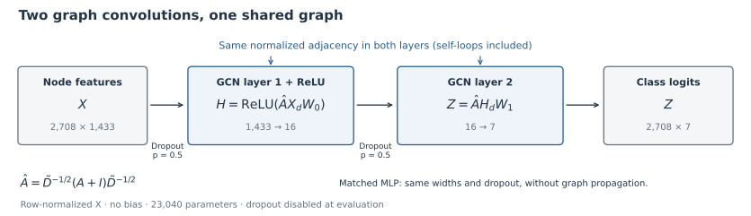

# GCN on Cora: Does Graph Propagation Help?

**Research question:** With only 140 labeled training nodes, how much does a two-layer GCN gain over a feature-only MLP on Cora when both use the same split, parameter count, and training protocol?

An independent PyTorch reproduction of the **Cora core experiment** in Kipf & Welling (ICLR 2017): transductive, semi-supervised node classification on one fixed public split.

## Two-layer GCN

Each graph convolution mixes neighboring node features using the same normalized adjacency, including self-loops. The matched MLP removes graph propagation while retaining the **1,433 → 16 → 7** widths and **23,040 trainable parameters**. Only training-node labels contribute to the supervised loss; all nodes' features and graph structure are available for propagation.

## GCN vs. MLP

| Model | Runs | Mean test accuracy | Sample std. |
| --- | ---: | ---: | ---: |
| **GCN** | 10 | **81.40%** | **0.64 pp** |
| MLP | 10 | 52.43% | 10.89 pp |

Cora: **2,708 nodes · 7 classes · 140 / 500 / 1,000 train / validation / test nodes**. Both models use the predeclared seeds 0–9 and the `official_code_last` protocol, evaluating the stopping-time `last.pt`. Error bars show sample standard deviation (`ddof=1`), **not confidence intervals**. [All 20 runs](results/test_runs.csv) · [Paired differences](results/paired_differences.csv) · [Evaluation protocol](docs/protocol.md)

## Conclusion and limits

**Graph propagation helps in this setting:** GCN exceeds MLP by **28.97 percentage points on average**, with a positive difference in all 10 seed pairs. GCN also varies less across these runs. Its 81.40% mean is close to the paper's 81.5% Cora reference, though this is a smaller, different implementation study.

- **One dataset, one split, 10 seeds.** These results measure training randomness on a fixed Cora split; they do not establish performance across datasets or splits. The paper's fixed-split references average 100 initializations.
- **The early-stopping rule matters.** MLP seed=0 stops after 22 epochs at 21.6% test accuracy and remains in every summary. The frozen rule uses validation CE + L2 and selects the final model. This comparison therefore measures graph propagation under that specific training protocol. [Early-stop analysis](docs/report_en.md#5-why-mlp-seed0-stops-after-22-epochs)
- **Implementation and scope differ.** PyTorch/dropout random streams differ from the original TensorFlow implementation. The loaded graph has 5,278 undirected edges versus 5,429 in the paper's table; this discrepancy remains unresolved. No additional datasets, ablations, or GPU speed reproduction are included. [Full scope and differences](docs/protocol.md)

## Explore and reproduce

The full report is available in English and Chinese, with figures in both languages.

| Start here | What you will find |
| --- | --- |
| [Full report (English)](docs/report_en.md) · [English PDF](https://github.com/jinglangqiu-hub/gcn-cora-reproduction/releases/download/v0.1.0/GCN_Cora_Report_v1.1_public_en.pdf) · [中文报告](docs/report.md) | Methods, results, training curves, and interpretation |
| [Training viewer](https://jinglangqiu-hub.github.io/gcn-cora-reproduction/) | Interactive history for all 20 completed runs; static data, no browser training |
| [Getting started](docs/getting_started.md) | CPU setup, training, evaluation, local live monitoring, and plotting commands |
| [Protocol](docs/protocol.md) · [Reproducibility](docs/reproducibility.md) | Frozen settings, checkpoint selection, and the same-machine seed=0 rerun |
| [Provenance](docs/provenance.md) · [Publication validation](docs/publication_validation.json) | Source mapping and checks performed on the public package |
| [Release v0.1.0](https://github.com/jinglangqiu-hub/gcn-cora-reproduction/releases/tag/v0.1.0) · [Artifact guide](artifacts/README.md) | Report PDF, all selected weights, predictions, logs, and checksums |

The two homepage figures are generated from the model definition and accepted result CSV by [this script](tools/plot_readme_figures.py); [their manifest](docs/figures/readme_figure_manifest.json) records input and output hashes. Existing report figures and historical results are preserved.

## Reference and credit

Thomas N. Kipf and Max Welling. [*Semi-Supervised Classification with Graph Convolutional Networks*](https://arxiv.org/abs/1609.02907v4). ICLR 2017. Reference implementation: [tkipf/gcn @ 39a4089](https://github.com/tkipf/gcn/tree/39a4089fe72ad9f055ed6fdb9746abdcfebc4d81).

Project author: **JinglangQiu** ([jinglangqiu-hub](https://github.com/jinglangqiu-hub)); Codex assisted with implementation checks, tooling, reporting, and publication. Project software: [MIT](LICENSE). See [third-party notices](THIRD_PARTY_NOTICES.md) for reference-code attribution; paper and data retain their source terms. To cite this project, use [CITATION.cff](CITATION.cff) and also cite the original paper for the research background.
