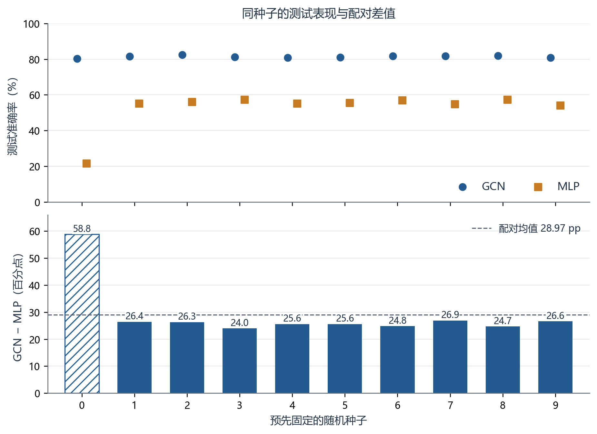
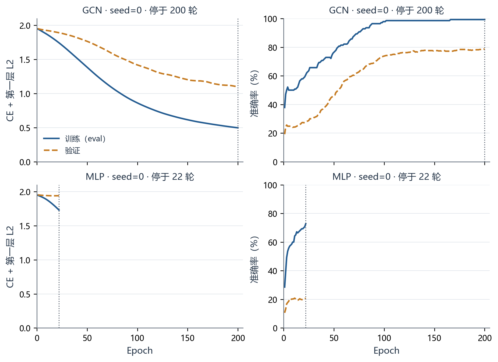
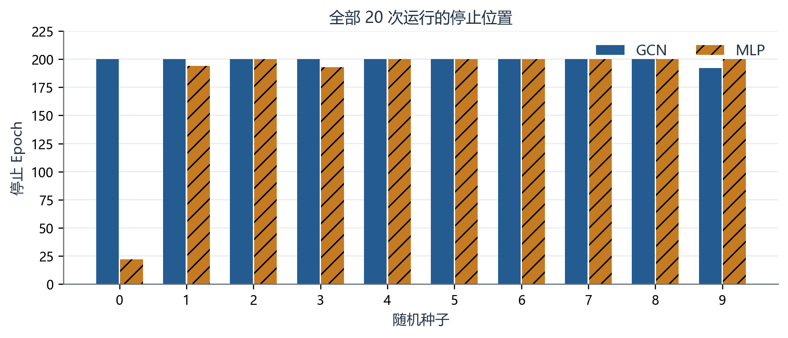
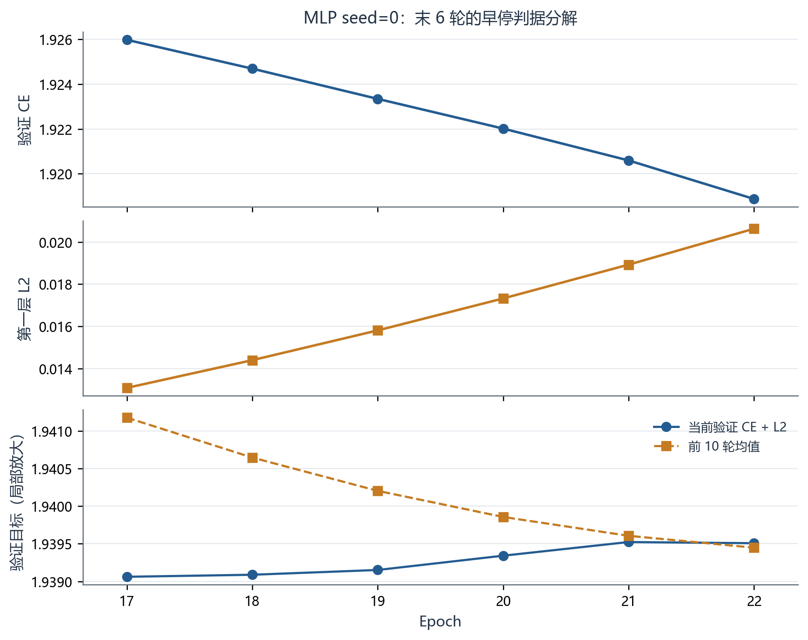

# 两层 GCN 的 Cora 核心实验复现

Kipf & Welling · ICLR 2017 · arXiv:1609.02907v4

实验日期：2026-10-29　文字修订：2026-10-30　版本：1.1（公开版）

[English edition / 英文版](report_en.md) · [项目首页](../README.md)

## 摘要

本次在 Cora 引文网络上，用 PyTorch 实现两层 GCN，并与参数量相同的两层 MLP 比较。两种模型使用相同的数据划分、超参数和事先确定的 10 个随机种子。**GCN 的平均测试准确率为 81.40%，样本标准差为 0.64 个百分点；MLP 为 52.43%，样本标准差为 10.89 个百分点。**按相同种子逐一比较，GCN 在全部 10 组中均更高，平均高出 28.97 个百分点。

GCN 的均值比论文参考值 81.5% 低 0.10 个百分点，MLP 比参考值 55.1% 低 2.67 个百分点。两组实验的重复次数、实现框架及早停依据存在差异，比较时需结合这些条件理解。本报告的范围为**Cora 核心实验复现**。[1][2]

| 模型 | 次数 | 测试均值 ± 标准差（%） | 论文参考（%） | 论文标准差 | 差值（百分点） |
| --- | --- | --- | --- | --- | --- |
| GCN | 10 | 81.40 ± 0.64 | 81.5（100 次） | 未报告 | -0.10 |
| MLP | 10 | 52.43 ± 10.89 | 55.1（100 次） | 未报告 | -2.67 |

![图 1　全部 20 次测试结果。圆点和方点代表单次运行，菱形及误差线表示本次均值 ± 样本标准差（ddof=1），用于展示种子间的波动，并非置信区间。空心三角为论文固定划分的均值；论文未报告该结果的同口径标准差。[1，第 7 页 Table 2/3]](figures/01_test_accuracy.png)

图 1　全部 20 次测试结果。圆点和方点代表单次运行，菱形及误差线表示本次均值 ± 样本标准差（ddof=1），用于展示种子间的波动，并非置信区间。空心三角为论文固定划分的均值；论文未报告该结果的同口径标准差。[1，第 7 页 Table 2/3]

本轮仅比较 Cora 上的两层 GCN 和 MLP。其他数据集、基线、消融及 GPU 速度实验未开展。全部预定种子均纳入统计，MLP seed=0 的低结果亦保留；测试后未改变参数、种子或最终权重。


---

## 1　研究问题、数据与实现

本次希望回答：当只有少量节点带有训练标签时，沿引文图聚合邻居信息，能否提高节点分类准确率？实验采用直推式半监督学习：模型可以读取全部节点的特征和图结构，但计算训练损失时只使用训练节点的标签。验证集用于决定何时停止训练；测试集在配置、种子和模型权重选定后，才用于最终评分。

| 数据项目 | 数量 | 实际范围或口径 |
| --- | --- | --- |
| 节点 / 特征 / 类别 | 2708 / 1433 / 7 | Cora，固定作者仓库数据文件 |
| 训练 | 140 | 节点 0–139，每类 20 个 |
| 验证 | 500 | 节点 140–639 |
| 测试 | 1000 | 节点 1708–2707，先按 test.index 恢复行顺序 |
| 其他节点 | 1068 | 节点 640–1707，参与传播但不提供训练标签 |
| 无向唯一边 | 5278 | 原邻接双向存储条目 10556，无原始自环 |
| 加自环后非零条目 | 13264 | 10556 + 2708；图对称，零特征行数为 0 |

数据准备分两步。先拼接 allx 与 tx，再根据 test.index 将测试特征 tx 和标签 ty 放回对应的节点位置。训练特征 x 已是 allx 的前 140 行，无须重复拼接。随后对特征矩阵 X 做行归一化；对邻接矩阵 A 做二值化和对称化，为每个节点加入一个自环，再按节点度数对称归一化。[2][3]

```text
A_tilde = A + I
A_hat = D_tilde^(-1/2) A_tilde D_tilde^(-1/2)
GCN logits = A_hat ReLU(A_hat X W0) W1
MLP logits = ReLU(X W0) W1
```

上式省略了 dropout：训练时，每层先随机将一部分输入置零，再做线性变换。GCN 还会乘以 A_hat 聚合邻居信息，第一层之后使用 ReLU；MLP 则对每个节点独立计算。两者均输出未经 softmax 的分类分数（logits），由交叉熵函数计算损失。下文用 CE 表示交叉熵，用 L2 表示第一层权重的正则项。

| 设置 | 冻结的实际值 |
| --- | --- |
| 网络与参数 | 1433 → 16 → 7；两模型均为 23040 个参数，bias=False |
| 初始化与 dropout | Xavier uniform；两层输入 dropout=0.5；同 seed 初始权重逐项相同 |
| 训练目标 | 140 个训练节点上 CE 的均值 + (5e-4/2) × sum(W0²) |
| 优化器 | Adam；lr=0.01，betas=(0.9,0.999)，eps=1e-8；amsgrad/foreach=False；weight_decay=0 |
| 训练与随机性 | 每轮使用整张图，最多 200 轮；随机种子为 [0,1,2,3,4,5,6,7,8,9] |
| 执行环境 | CPU、4 线程、确定性算法；float32；固定 Python/NumPy/Torch 随机种子 |


---

## 2　评估规则、与原文的差异及实现检查

本轮沿用作者代码的早停规则，记为 **official_code_last**。当从零计数的 epoch > 10 时，若当前验证目标（CE + L2）高于前 10 轮的平均值，就结束训练；否则继续，最多 200 轮。最终评估使用停止时保存的 last.pt。验证目标最低时的 best_val.pt 仅供分析，不用于替换最终权重。[2]

```text
if epoch > 10 and current_val_objective > mean(previous_10):
    stop
selected_checkpoint = last.pt
```

| 事项 | 论文 / 作者代码 | 本次处理与解释 |
| --- | --- | --- |
| 重复与划分 | 论文固定划分结果为 100 次初始化；另有随机划分实验 | 本次在同一固定划分上各运行 10 个种子，报告样本标准差。论文另一组随机划分实验的误差不能直接用于这里。 |
| 早停 | 论文文字为 10 个连续 epoch 验证损失不下降；作者代码为前 10 次均值判据 | 提前选择代码判据，并在所有正式运行及复跑中保持一致。 |
| Cora 边数 | 论文 Table 1 为 5429 条；本次文件实测为 5278 条无向唯一边 | 保留实测结果，并用 SHA-256 固定文件版本。目前尚未逐边核对差异，具体原因待查。 |
| 框架与 dropout | 作者使用 TensorFlow，首层对稀疏输入做 dropout | 本次使用 PyTorch，将 X 转为稠密矩阵后做 dropout，邻接矩阵仍保持稀疏。随机数序列和数值计算过程与原实现不同。 |
| 计时 | 论文给出特定 GPU 和软件环境下的训练时间 | 本次使用 CPU，计时还包括绘图等收尾工作，因此不直接比较训练速度。 |

正式训练在 Ryzen 9 8940HX 的 CPU 上运行，使用 4 个线程；本机有 16 核 / 32 线程、约 16 GB 内存。RTX 5070 Ti Laptop 未参与本轮正式训练。软件版本为 Python 3.11.18、torch 2.9.1+cu128、NumPy 1.26.4、SciPy 1.13.1、Matplotlib 3.9.2。[3]

| 检查 | 实际证据 |
| --- | --- |
| 数据 | 28 项检查全部通过，包括图的对称性、三组节点划分互不重叠、数据行顺序正确，以及没有 NaN 或无穷值。 |
| 传播与梯度 | 小图手算与程序结果一致，稀疏和稠密计算的输出及梯度一致；修改非训练节点标签不影响训练损失和梯度。 |
| MLP 对照 | GCN 的传播矩阵设为单位阵 I 后，输出和梯度与相同权重的 MLP 一致；修改 MLP 的非训练节点特征不影响训练节点输出。 |
| 运行完整性 | 20 次训练均正常结束，逐轮记录完整且数值有效，停止位置及权重哈希核对通过。独立重载后，训练/验证指标的最大差值为 0。 |
| 正式测试 | 评估程序先用可手算的小样例检查，再对 20 份已选定权重评分。保存的 2 万行节点预测及最终统计均已独立复核。 |


---

## 3　各随机种子的测试结果

| seed | GCN 测试（%） | MLP 测试（%） | 差值（百分点） | GCN 轮数 | MLP 轮数 |
| --- | --- | --- | --- | --- | --- |
| 0 | 80.4 | 21.6 | 58.8 | 200 | 22 |
| 1 | 81.6 | 55.2 | 26.4 | 200 | 194 |
| 2 | 82.5 | 56.2 | 26.3 | 200 | 200 |
| 3 | 81.3 | 57.3 | 24.0 | 200 | 193 |
| 4 | 80.8 | 55.2 | 25.6 | 200 | 200 |
| 5 | 81.1 | 55.5 | 25.6 | 200 | 200 |
| 6 | 81.8 | 57.0 | 24.8 | 200 | 200 |
| 7 | 81.7 | 54.8 | 26.9 | 200 | 200 |
| 8 | 82.0 | 57.3 | 24.7 | 200 | 200 |
| 9 | 80.8 | 54.2 | 26.6 | 192 | 200 |



图 2　上图比较相同种子下两种模型的测试准确率，下图给出 GCN - MLP 的差值。seed=0 用斜线标出，仍纳入统计。10 组差值均为正，范围为 24.0–58.8 个百分点；虚线表示平均差值。

每次测试都使用同一批 1000 个节点。先在每个种子下计算 GCN 与 MLP 的准确率之差，再汇总这 10 个差值，得到**平均差值 28.97 个百分点、样本标准差 10.52 个百分点**。这说明 GCN 在本轮所有配对中均表现更好，同时也显示优势幅度会随随机种子变化。[4]


---

## 4　训练过程与停止位置



图 3　预先指定的 seed=0 的训练与验证曲线。每轮更新参数后，关闭 dropout，在评估模式下计算两组指标；损失目标为 CE + 第一层 L2。横轴统一为 0–200 轮，MLP 曲线只画到实际停止位置。



图 4　全部运行的停止轮数。GCN seed=9 在 192 轮早停，其余达到 200 轮；MLP seed=0/1/3 分别在 22/194/193 轮早停，其余达到 200 轮。

在 seed=0 下，GCN 最终的训练准确率和验证准确率分别为 99.29%、78.60%，MLP 分别为 72.86%、20.60%。这些曲线用于观察学习过程；模型的最终比较仍以第 3 节的测试结果为准。所有运行采用相同的停止规则，因此实际训练轮数可以不同。[4][5]


---

## 5　MLP seed=0 为什么在第 22 轮停止

MLP seed=0 在第 22 轮触发了事先约定的早停条件，进程正常结束。原因是这一轮的验证目标首次高于前 10 轮均值。这里的“验证目标”同时包含 CE 和 L2：即使交叉熵在下降，只要正则项增加得更多，总目标仍可能上升并触发早停。[2][5]



图 5　最后 6 轮的验证目标分解。CE 持续下降，L2 持续上升，总目标因而趋于平稳后略有回升。三行使用各自的纵轴范围，最下图放大了总目标的细微变化；前 10 轮均值直接由原始记录计算。

| 量 | 第 22 轮的实际值 |
| --- | --- |
| 当前验证 CE + L2 | 1.9395076036453247 |
| 前 10 轮（12–21）均值 | 1.9394482612609862 |
| 差值 | 0.000059342384338467724 > 0，因此停止 |
| 选中 / 诊断权重 | last.pt：22 轮；best_val.pt：17 轮，仅诊断 |

从第 17 轮到第 22 轮，CE 由 1.925981 降至 1.918877，L2 由 0.013081 升至 0.020630。最终，这次运行的测试准确率为 21.6%，其余 9 次为 54.2%–57.3%。这一低结果拉低了 MLP 的均值，也增大了标准差，因此报告保留全部 10 次运行及其停止原因。以上分析解释了本次停止过程；继续训练会有何表现，还需要另设实验验证。


---

## 6　可重复性、结论与局限

为检查结果能否重复获得，实验开始前就选定 seed=0 作为复跑种子。在同一台机器和已固定的环境中，分别启动新的 Python 进程，从随机初始化开始重新训练 GCN 和 MLP，并将结果写入新目录。训练结束后，再与原运行的指标、权重和预测比较。这两次复跑仅用于一致性检查，不计入原 20 次统计。[6]

| 项目 | GCN seed=0 | MLP seed=0 |
| --- | --- | --- |
| 原运行 / 复跑轮数 | 200 / 200 | 22 / 22 |
| 原运行 / 复跑 test | 80.4% / 80.4% | 21.6% / 21.6% |
| 逐轮指标最大误差（除耗时） | 0 | 0 |
| 权重 / Adam / Torch RNG | 完全一致 | 完全一致 |
| 全图 logits / 测试概率最大差 | 0 / 0 | 0 / 0 |
| 预测 CSV | 逐字节一致 | 逐字节一致 |

检查前已约定：张量的相对容差为 1e-5（rtol），绝对容差为 1e-7（atol），逐轮指标的绝对容差为 1e-7。各项数值的实际比较误差均为 0。权重文件还包含运行编号等记录信息，因此一致性检查针对模型参数、优化器状态、随机数状态和预测内容；耗时单独记录。

## 结论

本轮完成了两层 GCN 的实现、同参数量 MLP 对照、各 10 个种子的训练与测试，以及 seed=0 的独立从头复跑。**在本次固定划分和训练设置下，利用图结构的 GCN 在全部 10 组配对中均取得更高的测试准确率。**GCN 均值接近论文参考值；MLP 均值较低，其中 seed=0 的低结果明显影响了均值与波动。

## 结果适用范围

• 本次使用一个固定划分和 10 次随机初始化。标准差描述的是种子之间的波动，尚不能说明更换训练/验证/测试划分后会有多稳定。

• 论文参考结果来自 100 次初始化。本轮的框架、首层 dropout 计算方式和随机数序列与原实现不同；早停遵循作者代码的均值窗口规则。

• 论文表中的边数与本次文件实测值不同，尚未逐边核对差异来源。数据版本和边数统计方式仍需进一步查证。

• 本轮未单独改变早停、L2、自环、网络深度或数据集来做对照，因此无法量化这些因素分别造成了多少结果差异。

• 复跑验证限于同机、同环境的新进程训练，尚未验证重装环境、换机器或跨 GPU/框架时的数值一致性。

后续可优先研究早停规则对 MLP 波动的影响：在实验前固定新的对照方案，比较作者的均值窗口规则与“连续若干轮无改善后停止、选用最佳验证权重”的规则。该对照属于后续实验，不纳入本轮结果。


---

## 7　公开版本的运行入口与证据

本公开版本保留前述实验数值、全部种子及早停口径，并将本机路径改为相对路径。原实验档案继续保留；公开代码的路径适配、检查记录及导出哈希见仓库 docs/provenance.md 和 export_manifest.json。

```text
git clone https://github.com/jinglangqiu-hub/gcn-cora-reproduction.git
cd gcn-cora-reproduction
python -m tools.prepare_data
python -m tools.train --model gcn --seed 0 --run-dir runs/gcn_seed00
python -m tools.evaluate --run-dir runs/gcn_seed00 --output-dir evaluations/gcn_seed00
python -m tools.summarize
python -m tools.plot_results --output-dir artifacts/plots
python -m tools.monitor_training --runs-root runs --port 8765
```

安装步骤及实际验收环境见 README。新运行和评估必须写入新目录，不追加到历史 20 项统计。数据下载固定作者版本，并核验文件哈希；test.index 的换行统一为原 Windows 源文件的 CRLF 后核对哈希。原模型计算与固定早停规则保持不变。

| 材料 | 公开位置 |
| --- | --- |
| 代码、配置与安装说明 | GitHub: jinglangqiu-hub/gcn-cora-reproduction |
| 全部历史测试结果与逐轮指标 | results/test_runs.csv、test_summary.json、metrics/ |
| 五组 PNG/SVG | docs/figures/；作图程序 tools/plot_results.py |
| 全部权重、预测、日志与校验清单 | Release v0.1.0: cora_evidence_v0.1.0.zip |
| 早停、来源与可重复性边界 | docs/protocol.md、provenance.md、reproducibility.md |
| 线上训练观察窗口 | jinglangqiu-hub.github.io/gcn-cora-reproduction/ |
| 发布版验收 | docs/publication_validation.json |

线上观察窗口展示 20 次已完成训练的历史曲线，可切换模型与种子、逐轮查看指标。它不在浏览器中执行训练。实时观察需在本机启动 monitor_training，读取新运行目录。两种界面均区分训练/验证指标与最终测试结果。

## 参考依据

[1] Kipf, T. N. & Welling, M. Semi-Supervised Classification with Graph Convolutional Networks. ICLR 2017, arXiv:1609.02907v4（[原文 PDF](https://arxiv.org/pdf/1609.02907v4)）。第 5 页 Table 1、第 6 页 §5.2、第 7 页 §6.1–6.2 / Table 2–3。

[2] [tkipf/gcn 固定版本](https://github.com/tkipf/gcn/tree/39a4089fe72ad9f055ed6fdb9746abdcfebc4d81)，commit 39a4089fe72ad9f055ed6fdb9746abdcfebc4d81；gcn/train.py、models.py、layers.py、utils.py、metrics.py。[3] 本地冻结合同与数据验证 JSON。[4] 正式 test_runs.csv / test_summary.json、预测及独立验收。[5] seed=0 early_stop_audit.json。[6] rerun_acceptance.json / prediction_csv_identity.json。

作者：JinglangQiu（GitHub: jinglangqiu-hub）。Codex 协助实现检查、工具、报告与发布。软件及参考代码版权说明见仓库 LICENSE 与 THIRD_PARTY_NOTICES.md；论文和数据保留各自来源。


## 在线原始依据

[论文 v4](https://arxiv.org/pdf/1609.02907v4)；[固定版本作者代码](https://github.com/tkipf/gcn/tree/39a4089fe72ad9f055ed6fdb9746abdcfebc4d81)。
