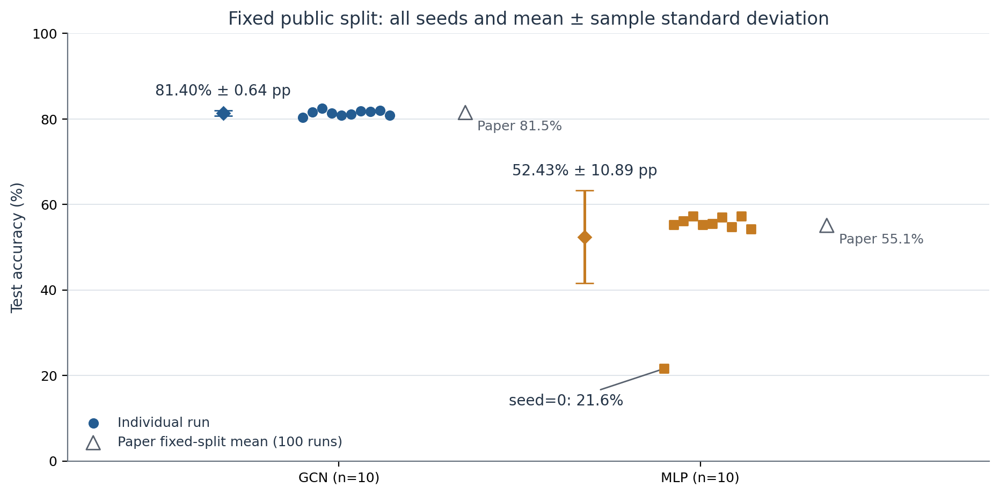
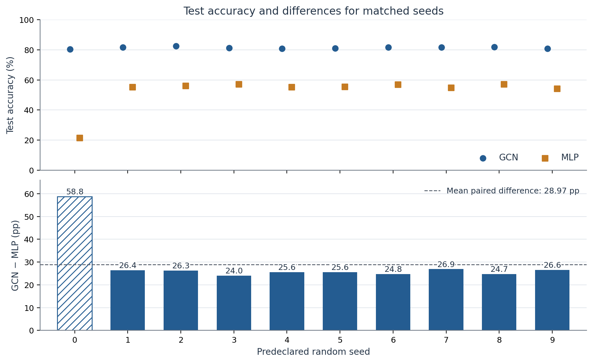
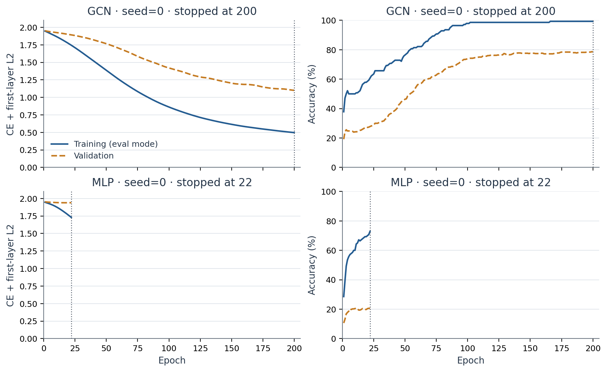
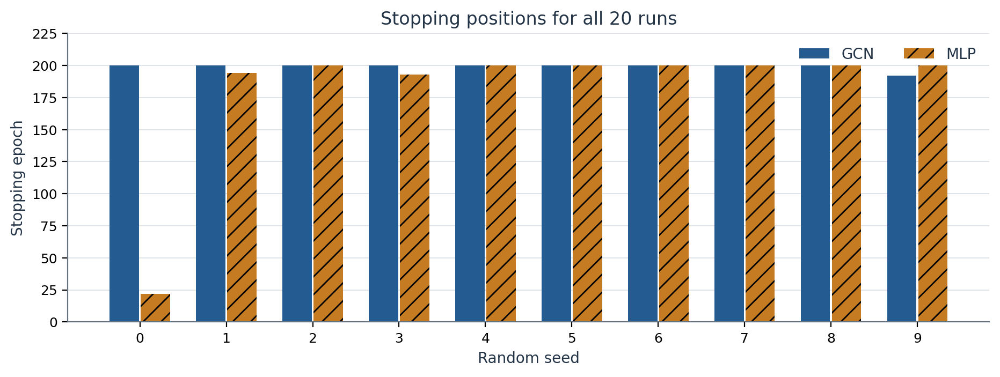
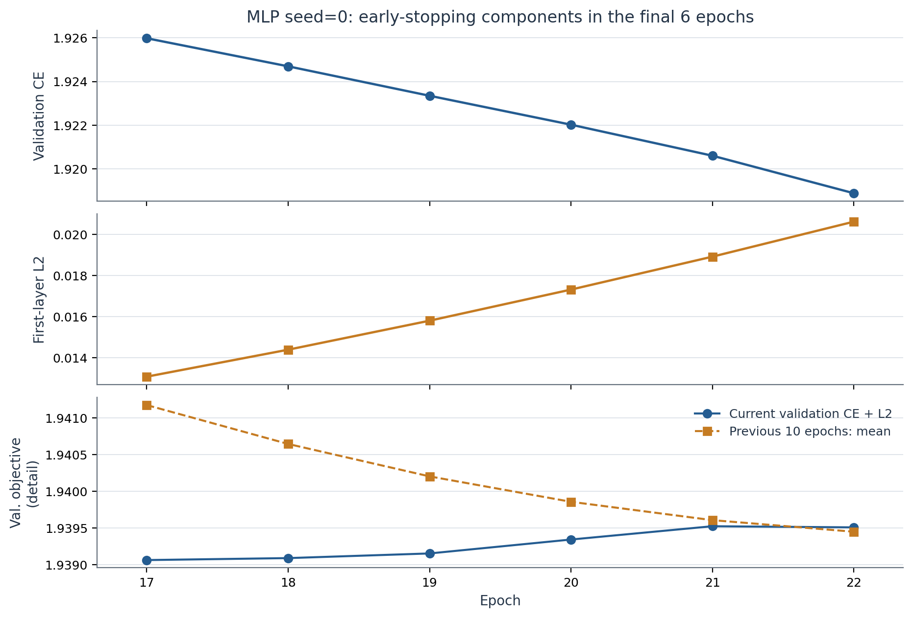

# Reproducing the Two-Layer GCN: Core Experiments on Cora

Kipf & Welling · ICLR 2017 · arXiv:1609.02907v4

Experiments: 2026-10-29 · Original text revised: 2026-10-30 · English edition: 2026-11-02 · Version: 1.1 (public edition)

[Project overview](../README.md) · [Chinese edition](report.md) · [Setup and commands](getting_started.md)

## Abstract

This study implements a two-layer graph convolutional network (GCN) in PyTorch on the Cora citation network and compares it with a two-layer multilayer perceptron (MLP) with the same parameter count. Both models use the same data split, hyperparameters, and ten predeclared random seeds. **GCN achieves a mean test accuracy of 81.40%, with a sample standard deviation of 0.64 percentage points; MLP achieves 52.43%, with a sample standard deviation of 10.89 percentage points.** GCN scores higher in all ten seed pairs, with a mean difference of 28.97 percentage points.

The GCN mean is 0.10 percentage points below the paper's 81.5% reference, while the MLP mean is 2.67 percentage points below its 55.1% reference. These comparisons require care: the number of repetitions, implementation framework, and early-stopping specification differ. The scope is a **reproduction of the core Cora experiments**, rather than all experiments in the paper. [1][2]

| Model | Runs | Test mean ± sample std. (%) | Paper reference (%) | Paper std. | Difference (pp) |
| --- | --- | --- | --- | --- | --- |
| GCN | 10 | 81.40 ± 0.64 | 81.5 (100 runs) | Not reported | -0.10 |
| MLP | 10 | 52.43 ± 10.89 | 55.1 (100 runs) | Not reported | -2.67 |



*Figure 1. All 20 test results. Circles and squares represent individual runs. Diamonds and error bars show this study's mean ± sample standard deviation (`ddof=1`), describing variation across seeds rather than confidence intervals. Open triangles show the paper's fixed-split means; the corresponding standard deviations were not reported. [1, p. 7, Tables 2–3]*

Only the two-layer GCN and MLP on Cora are compared here. Other datasets, baselines, ablations, and GPU speed experiments were not performed. All predeclared seeds are included, including the low MLP seed=0 result. Hyperparameters, seeds, and selected checkpoints were not changed after testing.

## 1. Research question, data, and implementation

The research question is whether aggregating neighboring information along citation edges improves node classification when only a small number of nodes have training labels. The setting is transductive semi-supervised learning: all node features and the full graph structure are available, but only training-node labels enter the supervised training loss. The validation set determines when training stops. The test set is scored only after the configuration, seeds, and checkpoints have been selected.

| Data item | Count | Actual range or counting convention |
| --- | --- | --- |
| Nodes / features / classes | 2708 / 1433 / 7 | Cora, using files from the fixed reference repository |
| Training | 140 | Nodes 0–139; 20 per class |
| Validation | 500 | Nodes 140–639 |
| Test | 1000 | Nodes 1708–2707; row alignment restored using `test.index` |
| Other nodes | 1068 | Nodes 640–1707; participate in propagation without providing training labels |
| Unique undirected edges | 5278 | 10556 directed storage entries; no original self-loops |
| Nonzero entries after self-loops | 13264 | 10556 + 2708; symmetric graph; 0 zero-feature rows |

Data preparation has two steps. First, concatenate `allx` and `tx`, then place the test features `tx` and labels `ty` at their corresponding node positions using `test.index`. Training features `x` already occupy the first 140 rows of `allx` and are not concatenated again. Next, row-normalize the feature matrix `X`; binarize and symmetrize the adjacency matrix `A`, add one self-loop per node, and apply symmetric degree normalization. [2][3]

```text
A_tilde = A + I
A_hat = D_tilde^(-1/2) A_tilde D_tilde^(-1/2)
GCN logits = A_hat ReLU(A_hat X W0) W1
MLP logits = ReLU(X W0) W1
```

Dropout is omitted from these equations. During training, dropout randomly zeros part of each layer's input before the linear transformation. GCN additionally multiplies by `A_hat` to aggregate neighbor information, with ReLU after the first layer. MLP processes each node independently. Both return unnormalized class scores, or logits, which are passed directly to cross-entropy loss. Below, CE denotes cross-entropy and L2 denotes the first-layer weight regularizer.

| Setting | Frozen value |
| --- | --- |
| Network and parameters | 1433 → 16 → 7; 23040 parameters for each model; `bias=False` |
| Initialization and dropout | Xavier uniform; dropout=0.5 on both layer inputs; identical initial weights for the same seed |
| Training objective | Mean CE over 140 training nodes + (5e-4/2) × sum(W0²) |
| Optimizer | Adam; lr=0.01, betas=(0.9,0.999), eps=1e-8; amsgrad/foreach=False; weight_decay=0 |
| Training and randomness | Full-graph training each epoch, at most 200 epochs; seeds [0,1,2,3,4,5,6,7,8,9] |
| Execution | CPU, 4 threads, deterministic algorithms; float32; fixed Python/NumPy/Torch seeds |

## 2. Evaluation protocol, differences from the original, and implementation checks

The selected protocol, **`official_code_last`**, follows the reference implementation's early-stopping rule. With zero-based epoch indexing, once `epoch > 10`, training stops if the current validation objective (CE + L2) exceeds the mean of the previous ten values. Otherwise, training continues for at most 200 epochs. Final evaluation uses the stopping-time `last.pt`. The checkpoint with the lowest validation objective, `best_val.pt`, is retained for diagnosis and does not replace the selected final checkpoint. [2]

```text
if epoch > 10 and current_val_objective > mean(previous_10):
    stop
selected_checkpoint = last.pt
```

| Item | Paper / reference implementation | Treatment and interpretation here |
| --- | --- | --- |
| Repetitions and splits | The paper's fixed-split results average 100 initializations; random-split experiments are separate | Each model uses 10 seeds on the same fixed split, with sample standard deviation reported. Error estimates from the paper's random-split experiments are not substituted here. |
| Early stopping | The paper describes no validation-loss decrease for 10 consecutive epochs; the code compares against the previous 10 values' mean | The code rule was selected in advance and used consistently for formal runs and reruns. |
| Cora edge count | Paper Table 1 reports 5429 edges; the loaded files yield 5278 unique undirected edges | The measured count is retained, with file versions fixed by SHA-256. The discrepancy has not been traced edge by edge; its cause remains unresolved. |
| Framework and dropout | TensorFlow, with sparse-input dropout in the first layer | PyTorch, with `X` converted to a dense matrix before dropout; adjacency remains sparse. Random streams and numerical execution differ. |
| Timing | The paper reports training times for a particular GPU/software environment | This study uses CPU; recorded end-to-end timing also includes finalization such as plotting, so training speed is not directly compared. |

Formal training ran on a Ryzen 9 8940HX CPU with 4 threads. The machine has 16 cores / 32 threads and approximately 16 GB RAM. Its RTX 5070 Ti Laptop GPU was not used for formal training. Software versions were Python 3.11.18, torch 2.9.1+cu128, NumPy 1.26.4, SciPy 1.13.1, and Matplotlib 3.9.2. [3]

| Check | Recorded evidence |
| --- | --- |
| Data | All 28 checks passed, including graph symmetry, disjoint train/validation/test splits, correct row alignment, and absence of NaN or infinite values. |
| Propagation and gradients | Toy-graph calculations matched the implementation; sparse and dense outputs and gradients agreed. Changing non-training labels did not affect training loss or gradients. |
| MLP control | Replacing the GCN propagation matrix with identity `I` produced the same outputs and gradients as MLP with identical weights. Changing non-training-node features in MLP did not affect training-node outputs. |
| Run integrity | All 20 training runs completed normally, with complete finite per-epoch records. Stopping positions and checkpoint hashes passed verification. Independently reloaded train/validation metrics had a maximum difference of 0. |
| Formal testing | The evaluator was first checked against hand-computable examples, then applied to the 20 previously selected checkpoints. All 20000 saved node-prediction rows and final statistics were independently checked. |

## 3. Test results by random seed

| Seed | GCN test (%) | MLP test (%) | Difference (pp) | GCN epochs | MLP epochs |
| --- | --- | --- | --- | --- | --- |
| 0 | 80.4 | 21.6 | 58.8 | 200 | 22 |
| 1 | 81.6 | 55.2 | 26.4 | 200 | 194 |
| 2 | 82.5 | 56.2 | 26.3 | 200 | 200 |
| 3 | 81.3 | 57.3 | 24.0 | 200 | 193 |
| 4 | 80.8 | 55.2 | 25.6 | 200 | 200 |
| 5 | 81.1 | 55.5 | 25.6 | 200 | 200 |
| 6 | 81.8 | 57.0 | 24.8 | 200 | 200 |
| 7 | 81.7 | 54.8 | 26.9 | 200 | 200 |
| 8 | 82.0 | 57.3 | 24.7 | 200 | 200 |
| 9 | 80.8 | 54.2 | 26.6 | 192 | 200 |



*Figure 2. The upper panel compares test accuracy for matched seeds; the lower panel shows GCN − MLP. Seed=0 is hatched and remains in the summary. All ten differences are positive, ranging from 24.0 to 58.8 percentage points; the dashed line marks their mean.*

Every test uses the same 1000 nodes. Computing the GCN-minus-MLP accuracy difference within each seed, then summarizing those ten differences, gives a **mean of 28.97 percentage points and a sample standard deviation of 10.52 percentage points**. GCN performs better in every pair in this study, while the size of its advantage varies across seeds. [4]

## 4. Training trajectories and stopping positions



*Figure 3. Training and validation curves for the predeclared seed=0. Both sets of metrics are computed after each parameter update in evaluation mode, with dropout disabled. The objective is CE + first-layer L2. All panels use the same 0–200 epoch scale; the MLP curve ends at its actual stopping position.*



*Figure 4. Stopping epochs for all runs. GCN seed=9 stops early after 192 epochs; the others reach 200. MLP seeds 0/1/3 stop early after 22/194/193 epochs; the others reach 200.*

For seed=0, GCN's final training and validation accuracies are 99.29% and 78.60%, respectively; MLP's are 72.86% and 20.60%. These curves describe the learning process; the final model comparison uses the test results in Section 3. All runs use the same stopping rule, which can yield different training lengths. [4][5]

## 5. Why MLP seed=0 stops after 22 epochs

MLP seed=0 triggers the predeclared early-stopping condition after 22 epochs and exits normally. Its validation objective exceeds the previous ten values' mean for the first time at that point. The objective contains both CE and L2: even when cross-entropy falls, the total can rise and trigger early stopping if the regularizer increases by a larger amount. [2][5]



*Figure 5. Decomposition of the validation objective over the final six epochs. CE decreases while L2 increases, causing the total objective to level off and then rise slightly. Each panel has its own vertical scale; the bottom panel magnifies the small change in the total objective. The previous-ten mean is calculated directly from the original records.*

| Quantity | Actual value at epoch 22 |
| --- | --- |
| Current validation CE + L2 | 1.9395076036453247 |
| Mean of previous 10 epochs (12–21) | 1.9394482612609862 |
| Difference | 0.000059342384338467724 > 0, triggering stopping |
| Selected / diagnostic checkpoint | `last.pt`: epoch 22; `best_val.pt`: epoch 17, diagnosis only |

From epoch 17 to epoch 22, CE falls from 1.925981 to 1.918877, while L2 rises from 0.013081 to 0.020630. This run's final test accuracy is 21.6%, versus 54.2%–57.3% for the other nine MLP runs. The low result lowers the MLP mean and increases its standard deviation, so all ten runs and their stopping reasons are retained. This analysis explains the observed stopping event; determining what would happen with longer training requires a separate experiment.

The epoch numbers in tables and plots count completed training epochs starting at 1; the stopping pseudocode in Section 2 uses the reference implementation's zero-based loop index.

## 6. Reproducibility, conclusions, and limitations

Seed=0 was selected for rerunning before the formal experiments. On the same machine and in the fixed environment, fresh Python processes trained GCN and MLP from random initialization, writing to new directories. Their metrics, weights, and predictions were then compared with the original runs. These two reruns are consistency checks and are excluded from the original 20-run statistics. [6]

| Item | GCN seed=0 | MLP seed=0 |
| --- | --- | --- |
| Original / rerun epochs | 200 / 200 | 22 / 22 |
| Original / rerun test | 80.4% / 80.4% | 21.6% / 21.6% |
| Maximum per-epoch metric difference, excluding time | 0 | 0 |
| Weights / Adam / Torch RNG | Exactly equal | Exactly equal |
| Maximum full-graph logit / test probability difference | 0 / 0 | 0 / 0 |
| Prediction CSV | Byte-identical | Byte-identical |

Predeclared tolerances were `rtol=1e-5` and `atol=1e-7` for tensors and an absolute tolerance of `1e-7` for per-epoch metrics. All measured numerical comparison errors were 0. Checkpoint files also contain metadata such as run identifiers, so equality was checked for model parameters, optimizer states, random-number states, and prediction contents rather than requiring whole-checkpoint byte identity. Timing was recorded separately.

### Conclusion

This study completed a two-layer GCN implementation, a matched-parameter MLP control, training and testing for ten seeds per model, and independent seed=0 reruns from scratch. **On this fixed split and under these training settings, GCN, which uses the graph structure, achieves higher test accuracy in all ten seed pairs.** Its mean is close to the paper's reference. MLP's mean is lower, with the low seed=0 result substantially affecting both the mean and variability.

### Scope and limitations

- One fixed split and ten random initializations are used. The standard deviation measures seed variability and does not establish stability under different train/validation/test splits.
- The paper's reference results average 100 initializations. This study differs in framework, first-layer dropout implementation, and random streams; early stopping follows the reference code's mean-window rule.
- The paper's tabulated edge count differs from the measured count in the loaded files. The difference has not been traced edge by edge; data-version and counting-convention questions remain open.
- No separate controlled experiments vary early stopping, L2, self-loops, network depth, or dataset, so their individual contributions to the result differences cannot be quantified.
- Rerun verification covers new processes on the same machine and environment. It does not establish numerical equality after environment reinstallation, on another machine, or across GPUs or frameworks.

A useful next experiment would study how the early-stopping rule affects MLP variability: freeze a new comparison protocol in advance and compare the reference mean-window rule with a patience-based rule that selects the best validation checkpoint. That comparison is future work and is not part of the results reported here.

## 7. Public reproduction commands and evidence

The public package preserves the reported results, all seeds, and the stopping protocol, while replacing machine-specific paths with relative paths. The original experiment archive remains intact. Public path adaptations, validation records, and exported checkpoint hashes are documented in [provenance.md](provenance.md) and [export_manifest.json](export_manifest.json).

Clone the repository, then install the dependencies as described in [Getting started](getting_started.md) before running the Python commands below:

```bash
git clone https://github.com/jinglangqiu-hub/gcn-cora-reproduction.git
cd gcn-cora-reproduction
# Install dependencies using docs/getting_started.md before continuing.
python -m tools.prepare_data
python -m tools.train --model gcn --seed 0 --run-dir runs/gcn_seed00
python -m tools.evaluate --run-dir runs/gcn_seed00 --output-dir evaluations/gcn_seed00
python -m tools.summarize
python -m tools.plot_report_en --output-dir artifacts/plots/report_en
python -m tools.monitor_training --runs-root runs --port 8765
```

See [Getting started](getting_started.md) for environment setup and the [publication validation record](publication_validation.json) for the public package's tested scope. Run and evaluation outputs must use new directories and are not appended to the historical 20-run statistics. Data downloads use the fixed reference commit and verify file hashes. Before hashing `test.index`, line endings are normalized to CRLF to match the original Windows source. The model computations and frozen stopping rule remain unchanged.

| Material | Public location |
| --- | --- |
| Code, configuration, and setup | [Project repository](https://github.com/jinglangqiu-hub/gcn-cora-reproduction) and [Getting started](getting_started.md) |
| All historical test results and per-epoch metrics | [test_runs.csv](../results/test_runs.csv), [test_summary.json](../results/test_summary.json), [metrics/](../results/metrics/) |
| Five English PNG/SVG figure pairs | [figures/en/](figures/en/), generated by [plot_report_en.py](../tools/plot_report_en.py); [figure manifest](figures/en/figure_manifest.json) |
| Original Chinese figures and plotter | [figures/](figures/) and [plot_results.py](../tools/plot_results.py) |
| All selected weights, predictions, logs, and checksums | [Release v0.1.0](https://github.com/jinglangqiu-hub/gcn-cora-reproduction/releases/tag/v0.1.0): `cora_evidence_v0.1.0.zip`; see the [artifact guide](../artifacts/README.md) |
| Stopping protocol, provenance, and reproducibility scope | [protocol.md](protocol.md), [provenance.md](provenance.md), [reproducibility.md](reproducibility.md) |
| Online training viewer | [GitHub Pages](https://jinglangqiu-hub.github.io/gcn-cora-reproduction/) |
| Public-package validation | [publication_validation.json](publication_validation.json) |

The online viewer displays historical curves for 20 completed runs, with model/seed selection and per-epoch inspection. It does not train models in the browser. Live monitoring requires running `monitor_training` locally to read new run directories. Both interfaces distinguish training/validation metrics from final test results.

This English edition translates the public Chinese report v1.1 and provides English versions of its five figures using the same source data. The Chinese report and its figures remain available. No new training or test evaluation was performed for the translation. The existing release PDF is the Chinese edition.

## References and evidence notes

[1] Kipf, T. N., and Welling, M. *Semi-Supervised Classification with Graph Convolutional Networks.* ICLR 2017, arXiv:1609.02907v4. [Paper PDF](https://arxiv.org/pdf/1609.02907v4): p. 5, Table 1; p. 6, Section 5.2; p. 7, Sections 6.1–6.2 and Tables 2–3.

[2] [Fixed reference implementation](https://github.com/tkipf/gcn/tree/39a4089fe72ad9f055ed6fdb9746abdcfebc4d81), commit `39a4089fe72ad9f055ed6fdb9746abdcfebc4d81`: `gcn/train.py`, `models.py`, `layers.py`, `utils.py`, and `metrics.py`.

[3] Original frozen experiment contract and data-verification JSON, retained in the local scientific archive. Public summaries and identifiers: [protocol](protocol.md), [data notes](../data/README.md), [provenance](provenance.md), and [export manifest](export_manifest.json).

[4] Formal [test_runs.csv](../results/test_runs.csv), [test_summary.json](../results/test_summary.json), [paired_differences.csv](../results/paired_differences.csv), prediction files, and independent acceptance records. Public predictions are available in the [release evidence archive](../artifacts/README.md).

[5] Historical seed=0 `early_stop_audit.json`, retained in the local scientific archive. Publicly inspectable inputs: [MLP seed=0 epoch metrics](../results/metrics/mlp_seed00.csv); the stopping calculation is reproduced in Section 5 and Figure 5.

[6] Historical `rerun_acceptance.json` and `prediction_csv_identity.json`, retained in the local scientific archive. Public summary: [reproducibility scope](reproducibility.md). Public-package validation is a separate check: [publication_validation.json](publication_validation.json).

Author: JinglangQiu ([jinglangqiu-hub](https://github.com/jinglangqiu-hub)). Codex assisted with implementation checks, tooling, reporting, translation, and publication. Software and reference-code attribution: [LICENSE](../LICENSE) and [THIRD_PARTY_NOTICES.md](../THIRD_PARTY_NOTICES.md). The paper and data retain their respective source terms.
